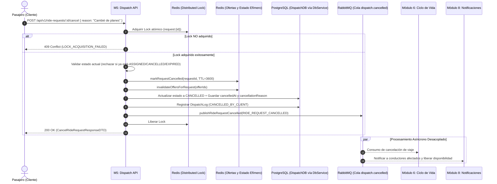
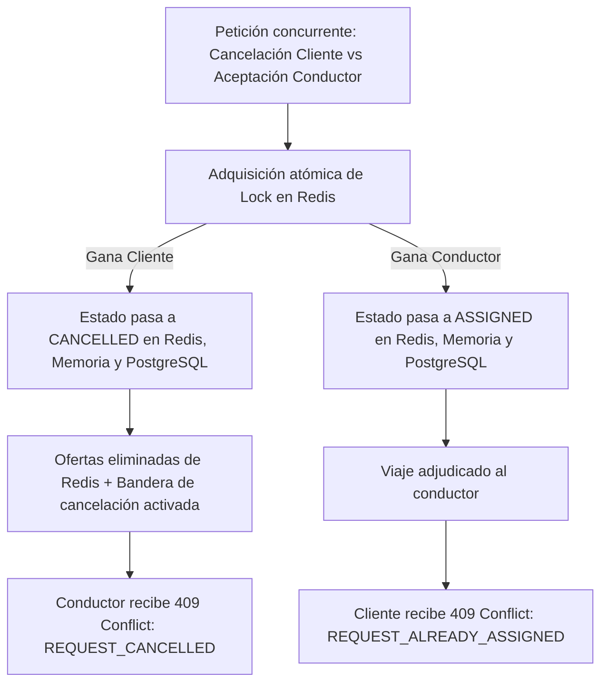

# Documentación Técnica — AE2 (Evolución Individual)
## Módulo 5: Servicio de Solicitud y Despacho
### Autor: Santino Mórtola (`colfredo32`)
### Requerimiento Asignado: RF-5.6 (Cancelación Previa de Solicitud de Viaje)

---

## 1. Introducción y Alcance (RF-5.6)

El requerimiento **RF-5.6 (Cancelación previa de solicitud de viaje)** permite que el pasajero/cliente anule su pedido de viaje antes de que se haya concretado la asignación definitiva a un conductor (es decir, durante las fases `PENDING`, `SEARCHING` o `OFFERED`).

En la evolución **AE1 → AE2 (Eje 3: Arquitectura y Comunicación entre Aplicaciones)**, la cancelación previa deja de ser una operación puramente en memoria y evoluciona hacia un flujo distribuido, asíncrono y resiliente, integrando:

1. **Redis (RNF-06):** 
   - Control estricto y exigencia de lock distribuido adquirido (`dispatch:lock:request:{requestId}`) con TTL para sincronizar carreras críticas.
   - Invalidación atómica inmediata de las ofertas emitidas que sigan activas (`dispatch:offer:{offerId}`).
   - Almacenamiento de bandera efímera de cancelación (`dispatch:request:{requestId}:cancelled`) con TTL para bloquear inmediatamente cualquier intento concurrente o posterior de aceptación.
2. **RabbitMQ (RNF-07):** Publicación de eventos de dominio (`RIDE_REQUEST_CANCELLED`) a la cola `dispatch.cancelled` para notificar asíncronamente a:
   - **Módulo 6 (Viajes y Ciclo de Vida):** Cierre y consolidación del ciclo de vida del viaje.
   - **Módulo 8 (Notificaciones, Documentos y Soporte):** Aviso asíncrono a los conductores cuyas ofertas fueron revocadas, liberando su disponibilidad sin bloquear al cliente.
3. **Persistencia Relacional y Propiedad de Datos (RNF-04 / DispatchDB):**
   - Transición de estado a `CANCELLED`, timestamp (`cancelledAt`), motivo (`cancellationReason`) persistidos formalmente en PostgreSQL mediante `DbService` (`Prisma ORM`).
   - Registro de auditoría append-only inmutable (`DispatchLog` / `DispatchAuditEvent`) sin borrados destructivos (`DELETE`).
4. **Concurrencia, Consistencia e Idempotencia (RNF-08, RNF-09, Criterio 7):** Sincronización atómica mediante locks distribuidos para resolver la condición de carrera crítica **"Cliente cancela vs. Conductor acepta simultáneamente"**.

---

## 2. Diagrama de Arquitectura y Secuencia de Cancelación



---

## 3. Tratamiento de Concurrencia, Lock Adquirido y Carrera Crítica (Criterio 7)

### 3.1. Exigencia de Lock Adquirido
Para evitar inconsistencias en ambientes distribuidos o de alta concurrencia:
- `cancelRideRequest` y `respondToOffer` exigen la adquisición efectiva del lock distribuido en Redis (`acquireLock`).
- Si `acquireLock` retorna `false`, se ejecuta un esquema de espera/reintento no bloqueante. Si tras los intentos el lock continúa tomado por una transacción concurrente, la petición se deniega con código `409 Conflict` (`LOCK_ACQUISITION_FAILED` o conflicto de estado detectado), impidiendo modificar memoria, base de datos o emitir eventos huérfanos.
- El bloque `finally` garantiza que solo el poseedor legítimo del lock (`if (lockAcquired)`) lo libere, previniendo liberar candados de terceros.

### 3.2. Escenario: Cliente cancela vs. Conductor acepta simultáneamente



* **Gana la cancelación:** Las ofertas en Redis son eliminadas inmediatamente y la solicitud se marca en Redis y en PostgreSQL como `CANCELLED`. Cuando el hilo del conductor intenta ejecutar `respondToOffer`, detecta la bandera en Redis o el estado cancelado y es rechazado con código `409 Conflict` (`REQUEST_CANCELLED`).
* **Gana la aceptación:** La solicitud queda marcada como `ASSIGNED`. Si el cliente intenta cancelarla, la validación de negocio detecta el estado asignado y rechaza la cancelación con código `409 Conflict` (`REQUEST_ALREADY_ASSIGNED`).

---

## 4. Matriz de Casos de Prueba (Excel de Aceptación)

| ID | Alcance | Caso de prueba | Pasos y datos | Resultado esperado | Estado |
| :--- | :--- | :--- | :--- | :--- | :--- |
| **CP-5.6-01** | Básico | Cancelar antes de ofertar | Crear una solicitud propia y cancelarla antes de enviar ofertas. | La solicitud queda `CANCELLED`, persistida en PostgreSQL/DbService, y no se asigna ningún conductor (`assignedDriverId === null`). | **PASÓ** |
| **CP-5.6-02** | Básico | Cancelar e invalidar las ofertas | Cancelar una solicitud con ofertas pendientes. Luego intentar aceptar una de esas ofertas con su ID anterior. | La solicitud permanece cancelada (`CANCELLED`), las ofertas se purgan de Redis y la aceptación es rechazada con `409 Conflict` (`REQUEST_CANCELLED`). | **PASÓ** |
| **CP-5.6-06** | Seguridad | Cancelar una solicitud ajena | Con sesión de B, intentar cancelar la solicitud de A enviando el ID de cliente A en el pedido. | Se deniega la operación con `403 Forbidden` (`FORBIDDEN_ACCESS`); la solicitud de A no cambia (`SEARCHING`) y el dato enviado no suplanta su identidad. | **PASÓ** |
| **CP-5.6-09** | Reintentos / Idempotencia | Repetir una cancelación | Cancelar una solicitud y repetir exactamente el mismo pedido. | La solicitud sigue cancelada y no se duplican sus efectos. La segunda respuesta coincide con la regla de contrato acordada: `409 Conflict` (`REQUEST_ALREADY_CANCELLED`). | **PASÓ** |
| **CP-5.6-10** | Regla a confirmar | Cancelar después de asignar | Asignar un conductor (estado `ASSIGNED`), pedir la cancelación previa y consultar solicitud, conductor y ofertas. | **Regla definida y aplicada:** No se permite cancelación previa después de asignar. Se rechaza con `409 Conflict` (`REQUEST_ALREADY_ASSIGNED`), se conserva la asignación y ninguna oferta anterior reactiva el viaje. | **PASÓ** |
| **CP-5.6-12** | Concurrencia crítica | Aceptar y cancelar juntos | Con una oferta vigente, lanzar aceptación y cancelación en paralelo mediante `Promise.allSettled`. | Si se confirma primero la cancelación, no puede asignarse después (`REQUEST_CANCELLED`). Si se confirma primero la asignación, la cancelación es rechazada (`REQUEST_ALREADY_ASSIGNED`). Exactamente una triunfa atómicamente y el estado final es consistente. | **PASÓ** |
| **CP-5.6-19** | Regresión | Volver a pedir después de cancelar | Cancelar una solicitud propia antes de asignar y, luego, crear otra con datos válidos y nueva clave de reintento. | La solicitud anterior sigue cancelada y se crea exitosamente la nueva solicitud (`SEARCHING`); no queda ningún bloqueo remanente impidiéndolo. | **PASÓ** |

---

## 5. Endpoints y Contratos REST (OpenAPI 3.0 / Scalar)

### Cancelación Previa (RF-5.6)
* **Método y Ruta:** `POST /api/v1/ride-requests/:requestId/cancel` *(alias: `DELETE /api/v1/ride-requests/:requestId`)*
* **Headers:** `x-user-id: <clientId>` (o `Authorization: Bearer <token>`)
* **Request Body (Opcional):**
```json
{
  "reason": "Demora excesiva en la búsqueda"
}
```
* **Response `200 OK`:**
```json
{
  "requestId": "43f6efe3-372f-44ce-9f03-6c502691c28d",
  "clientId": "client_101",
  "status": "CANCELLED",
  "reason": "Demora excesiva en la búsqueda",
  "cancelledAt": "2026-10-01T00:15:30.000Z",
  "message": "Solicitud de viaje cancelada exitosamente por el cliente."
}
```

### Respuestas de Error:
* `400 Bad Request` (`VALIDATION_ERROR`): Si el motivo excede 255 caracteres o es de tipo inválido.
* `403 Forbidden` (`FORBIDDEN_ACCESS`): Si un cliente intenta cancelar la solicitud de otro usuario (**CP-5.6-06**).
* `404 Not Found` (`RIDE_REQUEST_NOT_FOUND`): Si el ID de solicitud no existe.
* `409 Conflict` (`LOCK_ACQUISITION_FAILED`): Si no se puede adquirir el lock de concurrencia en Redis.
* `409 Conflict` (`REQUEST_ALREADY_ASSIGNED`): Si el viaje ya fue asignado a un conductor (**CP-5.6-10**).
* `409 Conflict` (`REQUEST_ALREADY_CANCELLED`): Si la solicitud ya fue cancelada previamente (**CP-5.6-09**).
* `409 Conflict` (`REQUEST_EXPIRED`): Si la solicitud ya superó el tiempo máximo de búsqueda.

---

## 6. Instrucciones de Ejecución y Pruebas

### 1. Pruebas Automatizadas (Jest)
```powershell
cd modulo-5
# Ejecutar todas las pruebas unitarias e integración:
npm test

# Ejecutar específicamente la suite de RF-5.6 con la matriz de casos de prueba del Excel:
npm test -- tests/unit/rf-5.6-cancellation-redis-rabbitmq.unit.test.ts
```

### 2. Despliegue con Docker Compose (Multi-Contenedor)
```powershell
cd modulo-5
docker compose up --build -d
```
* **API M5:** `http://localhost:3005`
* **Health Check con diagnóstico:** `http://localhost:3005/health`
* **Documentación Scalar:** `http://localhost:3005/docs` (o `http://localhost:3006`)
* **Panel RabbitMQ Management:** `http://localhost:15672` (usuario: `guest`, clave: `guest`)
